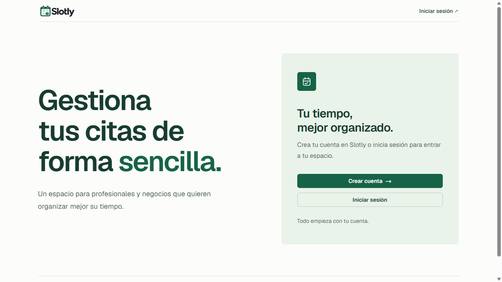

# Slotly

SaaS de gestión de citas y reservas para profesionales y negocios. Proyecto personal de portfolio centrado en autenticación, datos reactivos, disponibilidad, concurrencia y operaciones verificables. Un negocio por cuenta, con un único propietario y varios servicios.

**[Ver publicación](https://slotly-gold.vercel.app)** · [Arquitectura](docs/ARCHITECTURE.md) · [Operación](docs/OPERATIONS.md) · [Release y límites](docs/RELEASE.md)

*Captura histórica de la publicación del Reto20, 25/10/2026, 1280×720. Captura PNG nativa de planificación, conservada sin edición. La portada no acredita una sesión autenticada.*

## Qué permite hacer

- **Organizar la agenda:** vistas de día y semana, búsqueda, filtros, detalle, creación, cancelación y reprogramación de citas; historial conservado.
- **Configurar el negocio:** zona horaria, servicios editables con archivo/restauración, semana habitual, fechas especiales y bloqueos. Una misma disponibilidad gobierna las reservas privadas y públicas.
- **Atender citas:** llegada anticipada, avisos y resultados Completada/No asistió con Deshacer seguro. La prueba real después del fin de las citas del lunes26/10 sigue pendiente.
- **Gestionar clientes:** fichas e historial por negocio; las nuevas reservas con el mismo correo normalizado reutilizan la ficha dentro de ese negocio, sin mezclar cuentas.
- **Recibir reservas públicas:** enlace optativo, consultas limitadas, confirmación idempotente y recuperación del intento tras recarga.
- **Ofrecer autogestión:** las nuevas reservas públicas reciben un enlace privado para consultar, cancelar o reprogramar una cita futura. El movimiento conserva cita, cliente y duración histórica; el recibo original permanece inmutable.
- **Preparar confirmaciones por correo:** flujo transaccional con control de duplicados, reintentos y estados. Está implementado y **desactivado**; faltan remitente/credencial propios y envío real.

No incluye pagos, marketplace, múltiples empleados ni sincronización con calendarios externos.

## Estado comprobado

**Una única app, rama `main` y servicios de desarrollo.** Local y la publicación de Vercel comparten la instancia Clerk Development y el mismo backend Convex de desarrollo. No se mantienen perfiles de aplicación separados para practicar. Vercel llama Production al despliegue público de `main`; las claves y los datos utilizados son de desarrollo.

Google está configurado en Clerk Development con el cliente propio de Slotly. Se comprobó acceso real con la cuenta autorizada y persistencia tras recarga en la app local. La comprobación de la publicación desde Git se registra en [RELEASE.md](docs/RELEASE.md). Las pruebas del lunes26/10 conservan su alcance y están pendientes de su ejecución programada.

La cancelación y reprogramación públicas sí tienen E2E real de **desarrollo**, ejecutado por planificación con autorización: dos reservas, una ficha, movimiento conservando identidad y ambas citas finalmente canceladas. Las carreras y pérdidas de respuesta se probaron por separado contra el motor Convex/SQLite local; no se presentan como carreras cloud ni fallos de red del navegador.

La revisión de seguridad no confirmó vulnerabilidades dentro de su alcance; no es una garantía de ausencia de fallos ni una certificación de producción. [Cobertura y límites](docs/SECURITY_REVIEW.md).

## Stack y decisiones

Next.js16.4.2 con App Router, React19.3.0, TypeScript, Tailwind CSS4 y componentes shadcn/ui adaptados; Clerk Next7.9.17 y Convex1.47.0. Versiones efectivas en [package.json](package.json) y [pnpm-lock.yaml](pnpm-lock.yaml).

Clerk gestiona las sesiones. Next protege la entrada privada en servidor y Convex vuelve a verificar identidad y propietario en cada recurso privado. Las transacciones revalidan disponibilidad y revisión al guardar; un horario mostrado no reserva ocupación. Los comandos durables permiten reintentar la misma intención sin duplicar citas. [Diagrama y decisiones](docs/ARCHITECTURE.md).

## Desarrollo

Requisitos: Node24 LTS y pnpm12.11.2. Usar exclusivamente pnpm.

1. En una instalación nueva, `pnpm install --frozen-lockfile`.
2. Preparar Clerk y Convex **de desarrollo** siguiendo [.env.example](.env.example) y [OPERATIONS.md](docs/OPERATIONS.md). Las credenciales son propias y privadas; una copia ya configurada debe conservar `.env.local` y su destino.
3. Con el destino comprobado, ejecutar `pnpm convex:dev` y `pnpm dev` en terminales separadas. El primero sincroniza código/esquema; no es una lectura inocua.
4. Abrir la dirección anunciada por Next. En la sesión de trabajo conservada Slotly está en3001 y3000 pertenece a otra app: no reiniciar sus procesos ni iniciar otra copia para revisar documentación.

Conservar el único entorno de desarrollo existente y sus datos; no crear ni importar una segunda base para practicar. La guía operativa conserva los detalles de selección, configuración, arnés, recuperación y el diagnóstico histórico de instant UI. Los antecedentes de migración y decisiones permanecen en [PROJECT_CONTEXT.md](docs/PROJECT_CONTEXT.md).

## Verificación por capas

| Capa | Evidencia y límite |
| --- | --- |
| Código y compilación | `pnpm lint`, `pnpm typecheck` y `pnpm verify:build`. Este último exige Node24 y usa salida UUID propia, sin construir sobre `.next` del servidor activo. |
| Negocio y concurrencia | Arnés `test:appointments:engine` contra motor Convex/SQLite temporal real; no es una base cloud ni una prueba con cuenta real. Preparación y ejecución acotada en OPERATIONS. |
| Navegador real de desarrollo | E2E autorizados con recarga, diálogos, teclado, disponibilidad e historial; autoría y alcance en los contratos. |
| Publicación | Proyecto Vercel existente conectado a `main`, con Clerk y Convex de desarrollo. Evidencia actual y diferencias respecto a la publicación histórica20 en RELEASE. |
| Documentación21 | Enlaces, fuentes, imágenes, procedencia, privacidad y conservación comprobados; sin repetir campañas válidas ni escribir datos. |

El build local final20 utilizó Node24.19.0; no se confunde con el runtime remoto. Las suites antiguas en memoria y el alias retirado `test:local` son historia, no las puertas actuales. No hay un workflow remoto de CI creado en esta entrega.

## Contratos y evidencia

| Tema | Documento |
| --- | --- |
| Agenda, disponibilidad y cambios privados | [Agenda](docs/AGENDA_CALENDAR.md), [servicios](docs/SERVICES.md), [fechas especiales](docs/SPECIAL_DATES.md), [bloqueos](docs/TIME_BLOCKS.md) |
| Clientes e historial | [CLIENTS.md](docs/CLIENTS.md) |
| Llegada, avisos y resultados | [Atención](docs/APPOINTMENT_ATTENTION.md), [resultados](docs/APPOINTMENT_RESULTS.md) |
| Reservas, cancelación y movimiento públicos | [Reserva](docs/PUBLIC_BOOKING.md), [gestión pública](docs/PUBLIC_MANAGEMENT.md) |
| Correo transaccional desactivado | [EMAIL_CONFIRMATIONS.md](docs/EMAIL_CONFIRMATIONS.md) |
| Revisión, operación y publicación | [Seguridad](docs/SECURITY_REVIEW.md), [operación](docs/OPERATIONS.md), [release](docs/RELEASE.md) |
| Estado y cierre16–21 | [Estado actual e historia](docs/PROJECT_CONTEXT.md), [entrega y pendientes](docs/MVP_COMPLETION.md) |

Los contratos identifican quién ejecutó cada prueba, en qué entorno y con qué límites. Los informes privados completos, datos, respaldos y capacidades no se incorporan como assets de portfolio. El [README anterior](docs/history/README-before-portfolio.md) conserva el registro de etapas, sustituido como entrada por este documento.

Las entregas anteriores conservan su evidencia y límites. El estado vigente es una única aplicación de práctica en `main`, con servicios de desarrollo.
