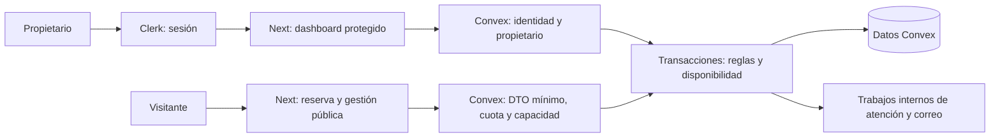
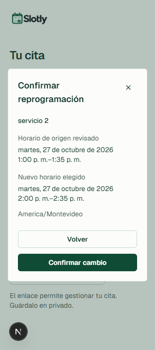

# Arquitectura y decisiones

Slotly resuelve citas para un negocio con un único propietario. La interfaz usa Next.js/React y componentes adaptados al tema; Clerk resuelve autenticación y Convex mantiene datos reactivos y reglas de negocio. Este mapa describe las fuentes actuales, no una propuesta de funcionalidades futuras.

## Límites de confianza

La página privada ejecuta `auth.protect()` antes de renderizar su contenido. El proveedor del cliente usa las APIs oficiales de Clerk para obtener credenciales; la autorización definitiva vuelve a ocurrir en Convex. Proteger la URL no protege una función llamada directamente. Las lecturas de sesión no se guardan en caché compartida entre usuarios.

`requireMyBusiness` deriva el negocio de la identidad verificada; `requireMyAppointment` comprueba que la cita le pertenezca. El cliente no decide su propietario ni puede reclamar un negocio por correo. Las funciones públicas tienen contratos específicos: DTO mínimos, límites de lectura y cuotas; no reutilizan un listado privado como endpoint anónimo.

Fuentes: [entrada privada](../app/dashboard/page.tsx), [proveedor de autenticación Convex](../components/convex-client-provider.tsx), [guardas de negocio](../convex/lib/appointmentData.ts), [esquema](../convex/schema.ts), [revisión y límites](SECURITY_REVIEW.md).

## Tiempo, ocupación e identidad

La semana y las fechas locales se interpretan en la zona IANA del negocio. Disponibilidad combina semana habitual, excepciones, bloqueos y citas que ocupan. La confirmación vuelve a comprobar esas reglas dentro de la transacción: una lectura previa puede haber quedado obsoleta. Los endpoints inválidos o ambiguos por cambios de horario no se convierten silenciosamente en otro instante.

Cancelar conserva historial y libera ocupación. Reprogramar mueve atómicamente origen/destino y conserva ID, cliente, nombre de servicio y duración histórica. Editar un servicio afecta las nuevas intenciones; no reescribe el intervalo de una cita anterior. Las revisiones y versiones impiden que un contexto viejo revierta un cambio posterior, incluso si el horario vuelve a parecer igual.

Clientes se deduplican por **negocio y correo normalizado**, dentro de la transacción que los necesita. El correo sirve para esa relación, no para autenticar ni conceder acceso a una cita. Las fichas anteriores sin correo no se fusionan por su nombre. [Contrato de clientes](CLIENTS.md), [identidad de cliente](../convex/lib/clientIdentity.ts), [disponibilidad](../convex/lib/availability.ts).

## Reintentos y autogestión pública

Cada confirmación mantiene UUID y payload estables. Repetir una intención recupera su acuse; cambiar el payload conservando UUID se rechaza. El recibo de creación conserva la confirmación original, mientras Gestionar cita consulta el estado actual.

Las nuevas reservas públicas emiten una capacidad aleatoria de256bits: el servidor guarda solo su hash. El enlace usa fragmento y la interfaz lo retira al recuperarlo; el acceso tiene vencimiento y revocación sin extenderse por recargas o movimientos. No se añaden accesos retroactivos a las reservas antiguas. La inspección acotada de terceros no prueba una filtración ni garantiza el SDK/CDN remoto.

Cancelar y mover usan diarios separados en la pestaña; ante resultado incierto, la interfaz recupera el mismo comando antes de admitir otra intención. Reprogramar reutiliza el resolver y la escritura efectiva de la operación privada. El acuse técnico por comando evita aplicar un UUID a otro destino; no es una nueva cita. [Contrato completo y E2E](PUBLIC_MANAGEMENT.md), [reserva pública](PUBLIC_BOOKING.md), [resolver de capacidad](../convex/lib/publicManagement.ts).

*Desarrollo real,25/10/2026,320×720. Captura nativa de planificación durante el E2E autorizado16/17: revisión de origen y destino para una cita del27/10. Conservada sin edición; no muestra capacidad, correo ni identificadores privados. La cita se movió y después quedó cancelada. No es una prueba de producción.*

## Trabajos y efectos externos

La cita y su contexto determinan los trabajos de atención. Versiones y guardas en servidor rechazan callbacks de un contexto anterior; invocarlos anticipadamente en una fixture no demuestra haber esperado al fin real de una cita. La prueba protegida del lunes26/10 sigue pendiente. [Atención](APPOINTMENT_ATTENTION.md), [resultados](APPOINTMENT_RESULTS.md).

La confirmación por correo registra un evento privado junto con la reserva. Trabajos internos gestionan claim, intentos, leases, watchdog y resultados inciertos; el payload enviado queda congelado. La activación exige configuración válida y decisión del propietario. **El transporte está desactivado y no se enviaron correos reales**; la evidencia usa proveedor controlado y no certifica entrega en una bandeja. [Contrato de correo](EMAIL_CONFIRMATIONS.md), [eventos](../convex/emailConfirmations.ts), [acción de envío](../convex/emailDispatch.ts).

## Despliegue y alcance de las pruebas

Vercel sirve Next; la publicación tiene su propia instancia Clerk y su propio backend Convex. El proxy oficial de Clerk permite usar la dirección del proveedor, con emisor OIDC comprobado. El desarrollo conserva configuración y datos. No se copiaron cuentas o negocios para hacer una demo pública.

El motor local verifica transacciones y concurrencia; el E2E de desarrollo verifica interacción y persistencia; las comprobaciones anónimas de producción verifican publicación y guardas. Son evidencias complementarias y ninguna sustituye las otras. Google y el flujo completo con cuenta real en producción siguen pendientes; tampoco se ejecutaron rollback real ni CI remoto. [Release exacta](RELEASE.md), [verificación y recuperación](OPERATIONS.md), [estado actual](PROJECT_CONTEXT.md).

Las capturas seleccionadas se publican como documentación, copiando sus bytes originales. Se omite la captura de reprogramación1280 porque repite el mismo diálogo; la de320 añade evidencia visual de su adaptación móvil. Su procedencia y hashes se conservan en la evidencia externa21, sin publicar los informes privados del desarrollo.
